<!--
  ╔═══════════════════════════════════════════════════════════════════════════╗
  ║                                                                           ║
  ║   ✨ NAEHA'S PROFILE ✨                                                   ║
  ║   A vibrant, pink-themed developer portfolio                              ║
  ║                                                                           ║
  ║   TODO: instagram handle · personal email · redeploy plannily             ║
  ╚═══════════════════════════════════════════════════════════════════════════╝
-->

<div align="center">

<!-- ═══════════════════════ HEADER ═══════════════════════ -->


<!-- ═══════════════════════ TYPING ANIMATION ═══════════════════════ -->
<a href="https://github.com/Naeha-S">
  
</a>

<br/>

<!-- ═══════════════════════ QUICK BADGES ═══════════════════════ -->
<p>
  
  &nbsp;
  <a href="https://github.com/Naeha-S?tab=followers">
    
  </a>
  &nbsp;
  
  &nbsp;
  
</p>

</div>

<!-- ═══════════════════════ MARQUEE BAR ═══════════════════════ -->


<div align="center">

```
✨  chrome extension live  ·  campus app deployed  ·  AR card game shipped  ·  ZKP in Python  ·  TypeScript every day  ✨
```

</div>


---

## 🩷 What I Shipped

<div align="center">

<table>
<tr>

<td align="center" width="50%">


<br/><br/>

Carries an AI conversation **into a new tab** without losing the thread.  
Context handoff — no copy-paste, no restart.

<br/>

<a href="https://chromewebstore.google.com/detail/chatbridge/baegfhggbncfinpoggngmphjodnppmai">
  
</a>
&nbsp;
<a href="https://github.com/Naeha-S/chatbridge">
  
</a>

</td>

<td align="center" width="50%">


<br/><br/>

Campus bus tracker for my own college.  
Tamil + English, offline-ready. No new data entry needed.

<br/>

<a href="https://rec-transit.vercel.app">
  
</a>
&nbsp;
<a href="https://github.com/Naeha-S/rec-transit">
  
</a>

</td>

</tr>
</table>

</div>

<!-- ═══════════════════════ CONTRIBUTIONS & LIVE ARCADE ═══════════════════════ -->


---

## 📊 Contributions & Live Arcade

<div align="center">

<!-- Crystal clear, high-contrast contribution graph upfront for recruiters -->
<a href="https://github.com/Naeha-S">
  
</a>

<br/><br/>

<!-- Real stats, streaks & top languages (hosted reliably on active endpoints) -->

&nbsp;


<br/><br/>


<br/><br/>

<!-- ═══════════════════════ LIVE ARCADE SHOWCASE ═══════════════════════ -->
### 🕹️ Real Commits Turned Into Games!

<p>
  <a href="#space-shooter-game"></a>
  &nbsp;
  <a href="#pac-man-game"></a>
  &nbsp;
  <a href="#snake-game"></a>
</p>

<!-- Game 1: Space Shooter -->
<h4 id="space-shooter-game">🚀 Space Shooter (Commits become enemy waves!)</h4>
<p><i>Live-generated from my actual commit history · compiles automatically every 24 hours</i></p>


<br/><br/>

<!-- Game 2: Pac-Man -->
<h4 id="pac-man-game">👾 Pac-Man (Chomping through my contribution dots!)</h4>



<br/><br/>

<!-- Game 3: Snake -->
<h4 id="snake-game">🐍 Retro Snake (Gliding over my contribution history)</h4>

<picture>
  <source media="(prefers-color-scheme: dark)" srcset="./assets/github-snake-dark.svg"/>
  <source media="(prefers-color-scheme: light)" srcset="./assets/github-snake.svg"/>
  
</picture>

</div>


---

## 💖 Who Is Naeha

<div align="center">

<table>
<tr>
<td width="52%" valign="top">

```js
const naeha = {
  pronouns : "she / her",
  location : "Chennai, India 🇮🇳",
  status   : "IT student by day 🎓",

  languages: ["TypeScript", "Python", "C", "Java"],
  learning : ["system design", "deeper Postgres"],

  creative : {
    design : ["Figma", "Photoshop", "Illustrator"],
    threeD : ["Blender 🫶"],
    video  : ["After Effects", "Animate"],
  },

  currentlyObsessedWith: "context windows & LLM handoffs",
  debuggingWith        : "pink sticky notes 💖",
  funFact              : "shipped a Chrome ext before learning React",
};
```

</td>
<td width="48%" align="center" valign="middle">


<br/>

<!-- Fun fact pills -->


<br/>


</td>
</tr>
</table>

</div>


---

## 🗂️ My Top Projects

<div align="center">

<table>
  <thead>
    <tr style="border-bottom: 2px solid #FF1493;">
      <th align="left">Project</th>
      <th align="left">What It Does</th>
      <th align="left">Stack</th>
      <th align="center">Status</th>
    </tr>
  </thead>
  <tbody>
    <tr>
      <td><b>🧠 <a href="https://chromewebstore.google.com/detail/chatbridge/baegfhggbncfinpoggngmphjodnppmai">Chatbridge</a></b></td>
      <td>Carries AI conversation into new tabs without losing context</td>
      <td><code>TypeScript</code> <code>Chrome APIs</code></td>
      <td align="center"></td>
    </tr>
    <tr>
      <td><b>🚌 <a href="https://rec-transit.vercel.app">REC Transit</a></b></td>
      <td>Campus bus tracking with Tamil + English support, runs offline</td>
      <td><code>TypeScript</code> <code>Vercel</code> <code>PWA</code></td>
      <td align="center"></td>
    </tr>
    <tr>
      <td><b>📉 Chatbridge Benchmark</b></td>
      <td>Kaggle benchmark scoring context survival across compression handoffs</td>
      <td><code>Python</code> <code>Data Analysis</code></td>
      <td align="center"></td>
    </tr>
    <tr>
      <td><b>🃏 Shared Table AR</b></td>
      <td>Snap Spectacles multiplayer card game built in Lens Studio</td>
      <td><code>JavaScript</code> <code>Lens Studio</code> <code>AR</code></td>
      <td align="center"></td>
    </tr>
    <tr>
      <td><b>🔐 <a href="https://github.com/Naeha-S/ZPK-">ZPK-</a></b></td>
      <td>Zero-Knowledge Proof protocol: prove truth without exposing data</td>
      <td><code>Python</code> <code>Cryptography</code></td>
      <td align="center"></td>
    </tr>
    <tr>
      <td><b>🔑 <a href="https://github.com/Naeha-S/Dynamic-Key-Folding-Cypher">Dynamic-Key-Folding-Cypher</a></b></td>
      <td>Custom encryption cipher deriving dynamic keys from messages</td>
      <td><code>C</code> <code>Algorithms</code></td>
      <td align="center"></td>
    </tr>
    <tr>
      <td><b>🌙 yuna-ai</b></td>
      <td>Autonomous AI assistant and workflow helper</td>
      <td><code>TypeScript</code> <code>LLMs</code></td>
      <td align="center"></td>
    </tr>
    <tr>
      <td><b>✈️ plannily</b></td>
      <td>AI-powered personalized travel planner & route creator</td>
      <td><code>TypeScript</code> <code>Vite</code></td>
      <td align="center"></td>
    </tr>
  </tbody>
</table>

</div>


---

## 💻 Tech Stack

<div align="center">

<!-- Category 1: Languages -->
<p><b>🎀 Core Languages</b></p>


<br/><br/>

<!-- Category 2: Frontend & Frameworks -->
<p><b>🚀 Frontend & Web Frameworks</b></p>


<br/><br/>

<!-- Category 3: Backend & Databases -->
<p><b>⚙️ Backend, Systems & Databases</b></p>


<br/><br/>

<!-- Category 4: Cloud & Environments -->
<p><b>☁️ Cloud & Environments</b></p>


<br/><br/>

<!-- Category 5: Creative Suite & Tools (Untouched as requested) -->
<p><b>🎨 Creative Suite & Workflow Tools</b></p>


</div>


---

## 🧩 Play With Me

<div align="center">

<table>
<tr>

<td align="center" valign="top" width="33%">

### 🧠 Spot The Bug

<details>
<summary><b>Round 1 · JS · <i>Which line?</i></b></summary>
<br/>

```js
const loadRoutes = async () => {
  const res = await fetch("/api/buses");
  const data = res.json();          // 👀
  return data.routes.map(r => r.id);
};
```
<sub><b>Answer:</b> <code>res.json()</code> needs <code>await</code>. Returns a Promise → <code>data.routes</code> is undefined → TypeError.</sub>
</details>

<details>
<summary><b>Round 2 · JS · <i>What prints?</i></b></summary>
<br/>

```js
for (var i = 0; i < 3; i++)
  setTimeout(() => console.log(i));
```
<sub><b>Answer:</b> <code>3 3 3</code> — <code>var</code> is function-scoped. Use <code>let</code> for <code>0 1 2</code>.</sub>
</details>

<details>
<summary><b>Round 3 · CSS · <i>Why won't it centre?</i></b></summary>
<br/>

```css
.card { position: absolute;
        left: 50%; top: 50%; }
```
<sub><b>Answer:</b> offsets the top-left corner, not the element. Add <code>transform: translate(-50%,-50%)</code> or use <code>grid + place-items:center</code> on the parent.</sub>
</details>

</td>

<td align="center" valign="top" width="33%">

### ⭕ Tic-Tac-Toe

You're **O** — it's your move!

```
X │ O │ X
──┼───┼──
O │ X │ ·
──┼───┼──
· │ · │ O
```

Open an **Issue** titled `ttt: [square]`  
*(1–9, top-left → bottom-right)*  
I'll reply and update the board 🩷

</td>

<td align="center" valign="top" width="33%">

### 🟩 Guess The Language

```
🟨⬜⬜⬜⬜⬜
🟩🟩🟨⬜⬜⬜
🟩🟩🟩🟩🟨⬜
🟩🟩🟩🟩🟩🟩
```

<details>
<summary><b>Reveal ✨</b></summary>
<br/>
<b>Rust</b> 🦀<br/>
borrow checker · <code>cargo</code> · ownership · lifetimes · <code>Result&lt;T,E&gt;</code>
</details>

<br/>

### ♟️ Chess

Live board via [marcizhu/readme-chess](https://github.com/marcizhu/readme-chess)  
Comment your move on the repo, a bot plays back!

</td>

</tr>
</table>

</div>


---

## 🗳️ Vote On What I Build Next

<div align="center">

<p><i>React to this README with an emoji to cast your vote!</i></p>

<table>
  <tr>
    <td align="center">🧠</td>
    <td><b>More Chatbridge</b> — Context preservation, LLM handoffs & compression</td>
  </tr>
  <tr>
    <td align="center">🚌</td>
    <td><b>More REC Transit</b> — Live GPS campus route telemetry & notifications</td>
  </tr>
  <tr>
    <td align="center">🔐</td>
    <td><b>More Cryptography</b> — Zero-knowledge proof protocols & ciphers</td>
  </tr>
  <tr>
    <td align="center">🎨</td>
    <td><b>More 3D & AR</b> — Blender animations & Snap Spectacles AR lenses</td>
  </tr>
</table>

</div>


---

## 🌸 Let's Connect

<div align="center">

<a href="https://linkedin.com/in/naeha-s">
  
</a>
&nbsp;
<a href="mailto:naeha.s.2024.it@rajalakshmi.edu.in">
  
</a>
&nbsp;
<a href="https://github.com/Naeha-S">
  
</a>
&nbsp;
<a href="https://instagram.com/YOUR_HANDLE">
  
</a>

<br/><br/>

> *"Code is like makeup — it should enhance, not overwhelm."*
>
> **— Naeha** 💖

<br/>


</div>
