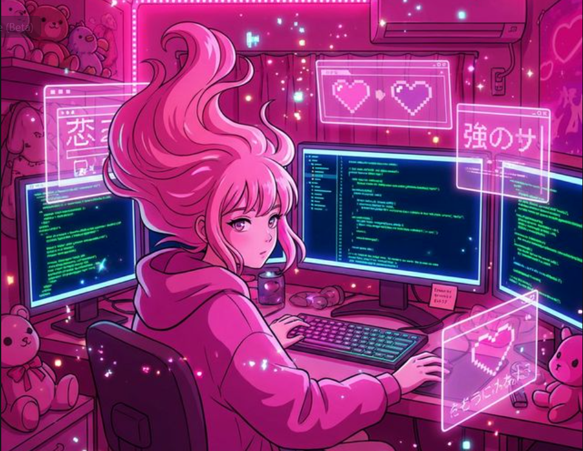
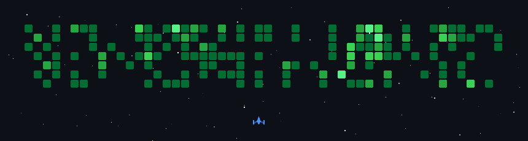

<!--
  ╔═══════════════════════════════════════════════════════════════════════════╗
  ║                                                                           ║
  ║   ✨ NAEHA'S PROFILE ✨                                                   ║
  ║   A vibrant, pink-themed developer portfolio                              ║
  ║                                                                           ║
  ║   TODO: instagram handle · personal email · redeploy plannily             ║
  ╚═══════════════════════════════════════════════════════════════════════════╝
-->

<div align="center">

<!-- ═══════════════════════ ANIMATED HEADER ═══════════════════════ -->


<!-- ═══════════════════════ TYPING ANIMATION ═══════════════════════ -->
<a href="https://github.com/Naeha-S">
  
</a>

<br/>

<!-- ═══════════════════════ BADGES ═══════════════════════ -->
<p>
  
  
  <a href="https://github.com/Naeha-S?tab=followers">
    
  </a>
  
</p>

</div>

<!-- ═══════════════════════ PINK DIVIDER ═══════════════════════ -->


## 🩷 Live right now

<div align="center">

<table>
<tr>
<td align="center" width="50%">

### 🧠 Chatbridge
Carries an AI conversation into a new tab without losing the thread.
<br/><br/>
<a href="https://chromewebstore.google.com/detail/chatbridge/baegfhggbncfinpoggngmphjodnppmai">
  
</a>

</td>
<td align="center" width="50%">

### 🚌 REC Transit
Campus bus tracking for my own college. Tamil + English, works offline.
<br/><br/>
<a href="https://rec-transit.vercel.app">
  
</a>

</td>
</tr>
</table>

</div>

<!-- ═══════════════════════ PINK DIVIDER ═══════════════════════ -->


## 💖 About Me

<table>
<tr>
<td width="55%">

```js
const naeha = {
  pronouns: "she/her",
  location: "Chennai, India 🇮🇳",
  education: "IT Student 🎓",

  code: ["TypeScript", "Python", "C", "Java"],
  learning: ["system design", "deeper Postgres"],

  creative: {
    design: ["Photoshop", "Illustrator", "Figma"],
    threeD: ["Blender"],
    video: ["Animate"]
  },

  currentFocus: "Shipping Chatbridge. Anything about context handling.",
  funFact: "I debug with pink sticky notes! 💖"
};</td> <td width="45%" align="center" valign="middle"></td> </tr> </table><!-- ═══════════════════════ PINK DIVIDER ═══════════════════════ -->
📌 Selected work
<details open> <summary><b>Things I built and can talk about</b></summary> <br/>
🧠 Chatbridge — live on the Chrome Web Store
📉 Chatbridge benchmark — Kaggle benchmark scoring how much context survives compression across a handoff
🚌 REC Transit — reads the schedule the transport office already maintains, so nobody has to migrate
🃏 Shared Table AR — Snap Spectacles card game in Lens Studio, ships with acceptance notes on what wasn't verified
🔐 ZPK- — Python. Proving a fact is true without exposing the underlying data
🔑 Dynamic-Key-Folding-Cypher — C. Encryption key derived from the message itself
🌙 yuna-ai — TypeScript
✈️ plannily — AI travel planner · demo down, redeploying
</details><!-- ═══════════════════════ PINK DIVIDER ═══════════════════════ -->
💻 Tech Stack
<!-- BENTO GRID LAYOUT --><div align="center"> <table> <tr> <td align="center" width="25%" style="padding: 20px;">
🎀 Languages
<br/> <br/><br/> <br/><br/>  </td> <td align="center" width="25%">
🚀 Frontend
<br/> <br/><br/> <br/><br/>  </td> <td align="center" width="25%">
⚙️ Backend & DB
<br/> <br/><br/> <br/><br/>  </td> <td align="center" width="25%">
🎨 Design
<br/> <br/><br/> <br/><br/>  </td> </tr> </table> <br/> <table> <tr> <td align="center" width="50%">
☁️ Cloud & DevOps
 </td> <td align="center" width="50%">
🛠️ Tools & Workflow
 </td> </tr> </table> </div><!-- ═══════════════════════ PINK DIVIDER ═══════════════════════ -->
🎮 The Arcade
<div align="center">  <br/> <i>🚀 Live generated gameplay based on my commit history!</i> </div><br/>
🐍 Snake eats my contributions
<div align="center"> <picture> <source media="(prefers-color-scheme: dark)" srcset="https://raw.githubusercontent.com/Naeha-S/Naeha-S/output/github-snake-dark.svg" /> <source media="(prefers-color-scheme: light)" srcset="https://raw.githubusercontent.com/Naeha-S/Naeha-S/output/github-snake.svg" />  </picture> <br/> <i>🕹️ Regenerates daily from my real commit history.</i> </div><br/>
👾 Pac-Man eats it too
<div align="center"> <picture> <source media="(prefers-color-scheme: dark)" srcset="https://raw.githubusercontent.com/Naeha-S/Naeha-S/output/pacman-contribution-graph-dark.svg" /> <source media="(prefers-color-scheme: light)" srcset="https://raw.githubusercontent.com/Naeha-S/Naeha-S/output/pacman-contribution-graph.svg" />  </picture> </div><br/>
🧠 Spot the bug
<details> <summary><b>Round 1 — JavaScript</b> · <i>which line breaks it?</i></summary> <br/>
js
const loadRoutes = async () => {
  const res = await fetch("/api/buses");
  const data = res.json();
  return data.routes.map((r) => r.id);
};
Answer: res.json() is missing await. It returns a Promise, so data.routes is undefined and .map throws TypeError. Needs await res.json().

</details><details> <summary><b>Round 2 — JavaScript</b> · <i>what does this print?</i></summary> <br/>
js
for (var i = 0; i < 3; i++) setTimeout(() => console.log(i));
Answer: 3 3 3. var is function-scoped, so all three callbacks close over the same binding after the loop finished. let gives 0 1 2.

</details><details> <summary><b>Round 3 — CSS</b> · <i>why doesn't the card centre?</i></summary> <br/>
css
.card { position: absolute; left: 50%; top: 50%; }
Answer: the element's own box isn't offset, so its top-left corner sits at the centre rather than the element. Either transform: translate(-50%, -50%) or, better, put display: grid; place-items: center on the parent.

</details><br/>
⭕ Tic-tac-toe — you're O
text
X │ O │ X
───┼───┼───
 O │ X │ ·
───┼───┼───
 · │ · │ O
Your move. Open an issue with the square number (1–9, top-left to bottom-right) and I'll play back. Board updates as we go.

<br/>
🟩 Guess the language
text
🟨⬜⬜⬜⬜⬜
🟩🟩🟨⬜⬜⬜
🟩🟩🟩🟩🟨⬜
🟩🟩🟩🟩🟩🟩
<details> <summary><b>Reveal</b></summary> <br/> <b>Rust</b> — borrow checker, <code>cargo</code>, <code>Result&lt;T, E&gt;</code>, ownership, <code>unsafe</code>, lifetimes. </details><br/>
🗳️ Vote on what I build next
React to this README:

🧠 → more Chatbridge
🚌 → more REC Transit
🔐 → more crypto / ZKP
🎨 → more Blender / AR
<br/>
♟️ Beat me at chess
The board is live in marcizhu/readme-chess — comment a move and a bot plays it back.

<!-- ═══════════════════════ PINK DIVIDER ═══════════════════════ -->
⏱️ Coding Activity
<div align="center">  <br/> <i>💡 Make sure your WakaTime profile is set to <b>Public</b> in settings!</i> </div><!-- ═══════════════════════ PINK DIVIDER ═══════════════════════ -->
📊 My Contributions
<div align="center"> 
<br/><br/>

 </div><!-- ═══════════════════════ PINK DIVIDER ═══════════════════════ -->
📈 GitHub Stats
<div align="center">   </div><!-- ═══════════════════════ PINK DIVIDER ═══════════════════════ -->
🏆 Achievements
<div align="center">  </div><!-- ═══════════════════════ PINK DIVIDER ═══════════════════════ -->
🌸 Let's Connect
<div align="center"> <a href="https://linkedin.com/in/naeha-s">  </a> &nbsp;&nbsp; <a href="mailto:naeha.s.2024.it@rajalakshmi.edu.in">  </a> &nbsp;&nbsp; <a href="https://github.com/Naeha-S">  </a> &nbsp;&nbsp; <a href="https://instagram.com/YOUR_HANDLE">  </a>
<br/><br/>
<i>"Code is like makeup - it should enhance, not overwhelm."</i>
<br/>
<b>- Naeha</b>

</div><br/><div align="center">  <br/> <b>💖 Thanks for stopping by! Have a sparkling day! ✨</b> <br/><br/>  </div> ```
